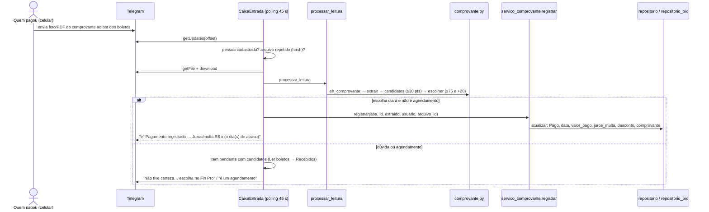
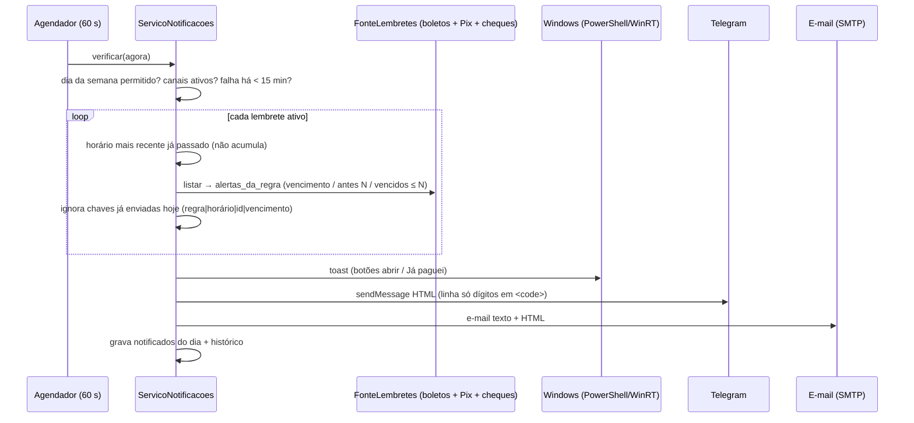
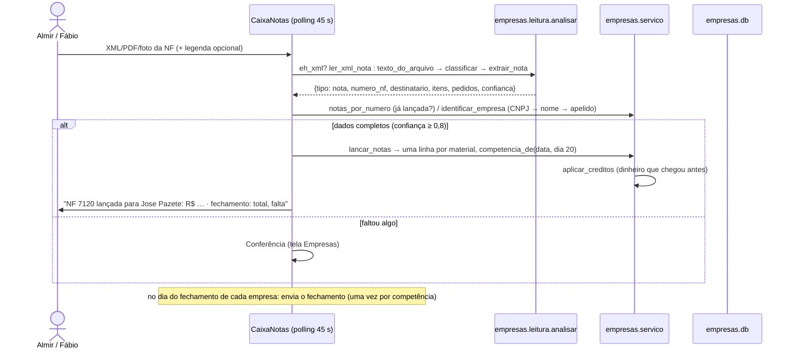
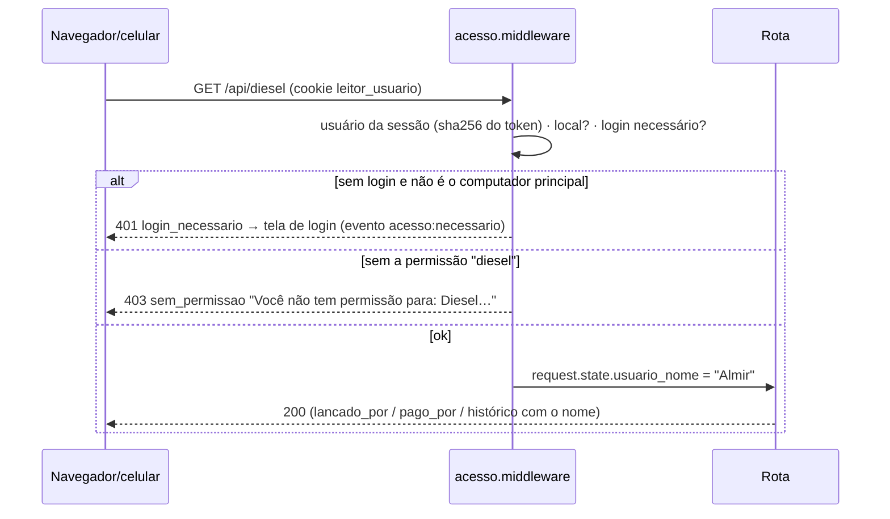

# 13 — Fluxos de ponta a ponta

Cada fluxo mostra **quem chama quem, em que ordem**, com o nome real das funções e rotas. Os diagramas usam Mermaid
(abrem no VS Code com extensão, no GitHub e na maioria dos visualizadores de Markdown). Abaixo de cada diagrama, as
regras que não podem ser esquecidas.

## 13.1 Ler um boleto pela tela e lançar

```mermaid
sequenceDiagram
    actor U as Usuário
    participant T as Tela Ler boletos
    participant A as API /api/leituras/tarefas
    participant G as GerenciadorTarefas (pool 2)
    participant S as servico_leitura.processar_leitura
    participant E as extrator.ler_arquivo
    participant C as servico_comprovante
    participant B as BancoBoletos (boletos.db)
    U->>T: arrasta PDF/foto (ou Ctrl+V)
    T->>A: POST multipart "arquivo" (progresso de upload)
    A->>G: cria tarefa → devolve {id}
    loop a cada ~1 s
        T->>A: GET /api/leituras/tarefas/{id}
        A-->>T: {etapa, pagina, paginas}
    end
    G->>S: processar_leitura(dados, nome, ao_progresso)
    S->>E: ler_arquivo (código de barras → texto/OCR → campos → consolidar)
    E-->>S: boletos[], texto
    S->>S: arquivos.salvar (original + prévia)
    S->>C: analisar_resultado (é comprovante?)
    alt é comprovante
        S-->>T: {comprovante: {extraido, candidatos, sugerido}}
    else é boleto
        S-->>T: {boletos: [...campos, confianca, alertas, duplicado]}
        U->>T: confere (amarelo = baixa confiança), escolhe centro de custo
        T->>B: POST /api/boletos/lote → aplicar_lote (uma transação)
        B-->>T: registros com id; histórico "Lançamento"
        B->>B: thread de sincronização gera boletos.xlsx (~1,5 s depois)
    end
```
Regras: código de barras já lançado → alerta `duplicado` e o lançamento é recusado; arquivo sem boleto → procura QR
Pix (`Lançar como Pix`); o original fica em `dados/arquivos` e é apagado em 2 dias se nunca for lançado.

## 13.2 Comprovante pelo Telegram → baixa automática



## 13.3 Lembrete do dia do vencimento


"Já paguei" no toast marca como pago (para os lembretes). O mesmo agendador dispara os **resumos** de segunda/sexta.

## 13.4 Nota fiscal pelo bot de notas → fechamento do dia 20



## 13.5 Cheque pré-datado: da foto ao depósito

```mermaid
sequenceDiagram
    actor A as Quem recebeu o cheque
    participant BN as Bot de notas
    participant SV as empresas.servico
    participant N as Lembretes
    A->>BN: foto frente e verso (legenda "pedido 7043, bom para 12/10" opcional)
    BN->>BN: OCR nas 4 orientações → extrair_cheque (CMC-7, valor #…#, bom para, emitente, pedidos do verso)
    BN->>SV: cheque_parecido? → lancar_cheque (Em carteira) → vincular_notas_ao_cheque (notas "Em cheque")
    N->>A: "Cheque para depositar hoje" (Windows/Telegram/e-mail)
    A->>BN: comprovante do banco "Depósito de cheque" (CMC-7 do cheque)
    BN->>BN: classificar → comprovante (regra de depósito vem antes do placar)
    BN->>SV: cheques_do_deposito (CMC-7 → número → valor; soma tem que bater)
    SV->>SV: compensar_cheque → registrar_recebimento (forma Cheque) → _aplicar nas notas
    BN->>A: "Depósito registrado: cheque nº 616 de Jose Pazete compensado em 24/09/2026"
```
Pela tela: **Depositei** (data + comprovante opcional) faz o mesmo `compensar_cheque`.

## 13.6 Canhoto de diesel com duas linhas pelo bot

```mermaid
sequenceDiagram
    actor F as Frentista/motorista
    participant BD as BotDiesel (polling 20 s)
    participant L as diesel.leitura
    actor G as Gestor ("quem escolhe a máquina")
    participant SV as diesel.servico
    F->>BD: foto do canhoto
    BD->>L: classificar (compra × canhoto) → itens_do_canhoto (trio litros×preço=total + rodapé)
    BD->>G: foto + "Linha 1 de 2 — Diesel comum · 200 L: de qual máquina?" [maq:…] [nova] [corr] [comb:…]
    G->>BD: toca "Pá carregadeira"
    BD->>G: "Qual o horímetro?" [pular]
    G->>BD: 5312,9
    BD->>G: "Linha 2 de 2 — Diesel S10 · 200 L: de qual máquina?"
    G->>BD: "Caminhão Volvo" → km
    BD->>SV: lancar_canhoto(itens, comum, arquivo)
    SV-->>BD: abastecimentos; saldo() em R$; media_da_maquina
    BD->>G: "✅ 200 L de Diesel comum em Pá carregadeira … 🛢️ Saldo do diesel: R$ 4.610,00 … 📊 médias"
    BD->>F: "✅ Seu canhoto foi lançado"
    alt saldo ≤ alerta_valor
        BD->>G: "⚠️ Diesel acabando: restam só R$ …"
    end
```

## 13.7 Edição feita à mão no Excel

```mermaid
sequenceDiagram
    actor U as Usuário
    participant X as boletos.xlsx (Excel)
    participant S as Thread de sincronização
    participant DB as boletos.db
    U->>X: muda Status/Centro de custo e salva
    S->>X: mtime mudou desde a última exportação?
    S->>DB: compara cada linha com o snapshot (exportado) e com o atual
    S->>DB: aplica só os campos editáveis que a pessoa mudou (usuário "Planilha Excel (edição manual)")
    S->>X: exporta de novo (se o Excel ainda estiver aberto: tenta depois; nada se perde)
```

## 13.8 Login e permissão


